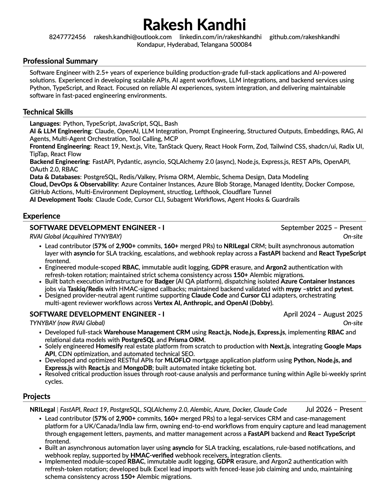
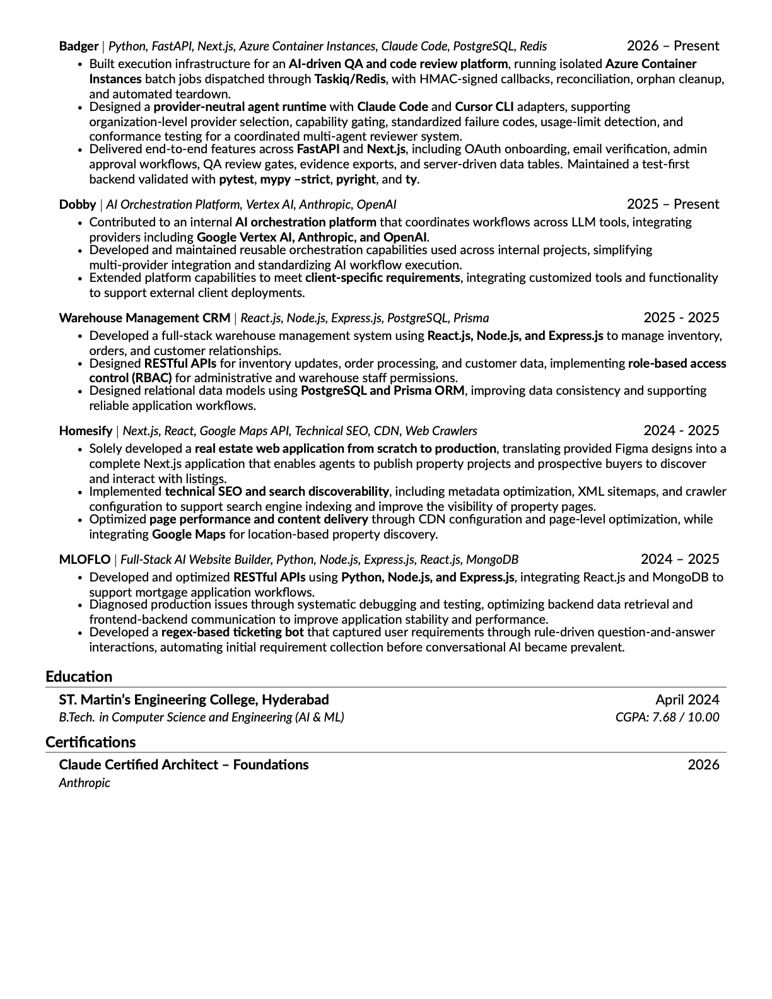

<div align="center">

# Rakesh Kandhi — Software Engineer

<p>
  <strong>Full-Stack &amp; AI Engineering &bull; 2.5+ Years Experience</strong><br>
  Kondapur, Hyderabad, Telangana &bull; <a href="mailto:rakesh.kandhi@outlook.com">rakesh.kandhi@outlook.com</a>
</p>

<p>
  <a href="https://rakeshkandhi.github.io/RAKESH_KANDHI/"></a>
  <a href="https://rakeshkandhi.github.io/RAKESH_KANDHI/resume.pdf"></a>
  <a href="https://www.linkedin.com/in/rakeshkandhi"></a>
  <a href="https://github.com/rakeshkandhi"></a>
</p>

---

[🌐 View Live Resume Website](https://rakeshkandhi.github.io/RAKESH_KANDHI/) &bull; [📄 Download Latest PDF](https://rakeshkandhi.github.io/RAKESH_KANDHI/resume.pdf)

</div>

## 📌 Overview

This repository hosts the source code, modular structure, and automated build pipeline for my professional software engineering resume. Built on modern LaTeX and typeset using the high-performance **Tectonic** Rust engine, it is strictly formatted to pass **Applicant Tracking Systems (ATS)** while maintaining clean typography and layout balance.

---

## 👁️ Preview

<div align="center">

| Page 1 — Experience & Core Tech | Page 2 — Flagship Projects & Education |
| :---: | :---: |
|  |  |

</div>

---

## 🛠️ Technical Stack Summary

- **Languages**: Python, TypeScript, JavaScript, SQL, Bash
- **AI &amp; LLM Engineering**: Claude, OpenAI, LLM Integration, Prompt Engineering, Structured Outputs, Embeddings, RAG, Multi-Agent Orchestration, Tool Calling, MCP
- **Backend**: FastAPI, Pydantic, asyncio, SQLAlchemy 2.0 (async), Node.js, Express.js, REST APIs, OAuth 2.0, RBAC
- **Frontend**: React 19, Next.js, Vite, TanStack Query, React Hook Form, Zod, Tailwind CSS, shadcn/ui, Radix UI
- **Data &amp; Databases**: PostgreSQL, Redis/Valkey, Prisma ORM, Alembic
- **Cloud &amp; DevOps**: Azure Container Instances, Azure Blob Storage, Docker Compose, GitHub Actions, structlog

---

## 📂 Repository Structure

```plaintext
RAKESH_KANDHI/
├── resume.tex              # Main LaTeX entry point (ATS layout, Lato font)
├── custom-commands.tex     # Formatting macros (\resumeSubheading, \resumeItem)
├── Makefile                # Fast dev targets (make build, make open)
├── build.sh                # Executable build script
├── src/                    # Modular LaTeX source components
│   ├── heading.tex         # Name, contact info, social links
│   ├── objective.tex       # Professional summary
│   ├── skills.tex          # Categorized technical competencies
│   ├── experience.tex      # Employment history & key production metrics
│   ├── projects.tex        # Flagship engineering projects
│   └── education.tex       # Degree and certifications
├── docs/                   # GitHub Pages deployment
│   ├── index.html          # Web-based resume viewer
│   └── resume.pdf          # Latest live PDF
├── resumes/
│   └── RAKESH_KANDHI.pdf   # Active output PDF
└── assets/                 # High-res preview thumbnails for README
```

---

## 🚀 Local Development & Building

### Prerequisites

Install the [Tectonic](https://tectonic-typesetting.github.io/) LaTeX engine via Homebrew (macOS):

```bash
brew install tectonic
```

### Build Commands

```bash
# Build the PDF using Makefile
make build

# Build and instantly open in Safari
make open

# Or compile directly using tectonic
tectonic resume.tex
```

---

<div align="center">
  <sub>Maintained by <a href="https://github.com/rakeshkandhi">Rakesh Kandhi</a> &bull; Last updated October 2026</sub>
</div>
